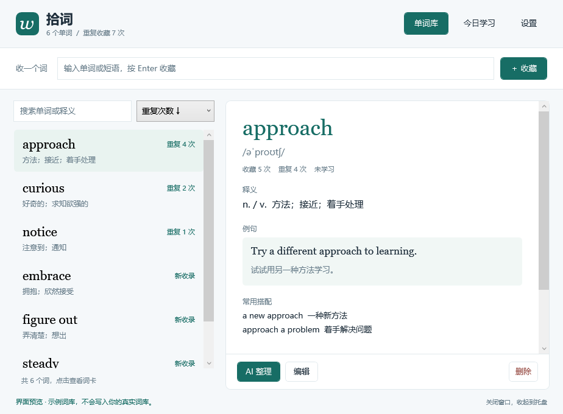

<p align="center">
  
</p>

# My Words · 拾词

A local vocabulary notebook for the Windows system tray, with DeepSeek-powered word cards and an optional Manggo Pro integration. Built for Chinese speakers learning English. **The app UI is currently in Chinese.**

**[Download for Windows x64](https://github.com/guan695/my-words/releases/latest/download/MyWords-Windows-x64.zip)** · [Manggo plugin](https://github.com/guan695/my-words/releases/latest/download/MyWords.mplugin) · [简体中文](README.md)



*An offscreen render of the actual WPF UI using sample data. A new installation starts with an empty library.*

## Why My Words?

Looking up a word is easy. Remembering the words you keep looking up is harder. My Words keeps that loop small: **collect a word, notice repeats, enrich its card, and revisit it each day.**

- **One entry per word.** Repeated saves increment a visible counter instead of creating duplicates.
- **Search and sort.** Find words by spelling or meaning, then sort by repetition count, alphabet or insertion order.
- **AI cards, your prompt.** Generate pronunciation, meaning, examples, translations, collocations and a memory hint with DeepSeek. Edit every field yourself.
- **Up to 20 words a day.** Review from your own library with recall-first cards and three confidence ratings. The daily list survives restarts.
- **Manggo Pro integration.** Save directly after a translation and see how often you have saved that word before.
- **A quiet tray app.** Closing the window hides it; the tray menu can open the library, open daily study or quit.
- **Local storage.** JSON import/export, a previous-save backup and no My Words account required.

## Get started

1. Download and extract the [Windows x64 package](https://github.com/guan695/my-words/releases/latest/download/MyWords-Windows-x64.zip).
2. Keep all extracted files together and launch `MyWords.exe`. This package includes the .NET runtime.
3. Type an English word or short phrase and press Enter. Saving it again increments its count.
4. Optionally enter your own DeepSeek API Key in Settings to enrich new cards automatically. Existing cards have an AI action too.

The core notebook works without AI. DeepSeek API usage is billed to your own account; ChatGPT Pro and Manggo Pro do not include DeepSeek API credits. The model name is editable in Settings.

Targets Windows 10/11 x64. If you already have [.NET 8 Desktop Runtime x64](https://dotnet.microsoft.com/en-us/download/dotnet/8.0), you can use the smaller [framework-dependent package](https://github.com/guan695/my-words/releases/latest/download/MyWords-Windows-x64-framework-dependent.zip).

## Connect Manggo Pro

1. Open Manggo's plugin manager and **Initialize Plugin Environment**. Wait until it says **Ready**.
2. Install [MyWords.mplugin](https://github.com/guan695/my-words/releases/latest/download/MyWords.mplugin), then add My Words as a wordbook service.
3. In My Words, copy the connection token from Settings and paste it into the plugin's service configuration.
4. Keep My Words running, including in the tray, and save a word from Manggo's translation window.

`Plugin runtime environment is not initialized.` means step 1 is still required. Installing the plugin alone does not initialize Manggo's runtime.

The plugin connects only to `127.0.0.1:17653` and authenticates with the pairing token. Manggo Pro is required for the integration, not for the standalone notebook.

## Your data

Words live in `%LOCALAPPDATA%\MyWords\words.json`; settings live beside them. The DeepSeek key is encrypted for the current Windows user. An AI request sends the selected word, existing meaning, pronunciation and your prompt to DeepSeek, not the entire library. Exports exclude the API Key.

Repeated saves never automatically regenerate a card. Collection timestamps and example history are not stored. Normalization merges case and extra whitespace; inflections such as `run` and `running` remain separate.

Daily selection is weighted toward forgotten, new and repeatedly collected words. This release does not implement a full spaced-repetition scheduler, cloud sync, mobile apps or an auto-start setting. AI-generated information can be edited and should be checked.

## Build and contribute

On Windows with the .NET 8 SDK and PowerShell:

```powershell
git clone https://github.com/guan695/my-words.git
cd my-words
.\scripts\build.ps1 -SelfContained
```

Build output is in `release/`. Omit `-SelfContained` for a framework-dependent package. See [CONTRIBUTING.md](CONTRIBUTING.md) for project structure and targeted checks, and the [Chinese user guide](docs/guide.md) for troubleshooting.

Bug reports, ideas and small pull requests are welcome through [Issues](https://github.com/guan695/my-words/issues). If the app helps you, a **Star** helps others discover it.

Thanks to [Manggo](https://manggo.pylogmon.cn/), its [plugin documentation](https://github.com/Pylogmon/manggo-plugin), and [DeepSeek](https://api-docs.deepseek.com/). This is an independent community project, not an official product of those services.

[MIT License](LICENSE) © 2026 [guan695](https://github.com/guan695)
