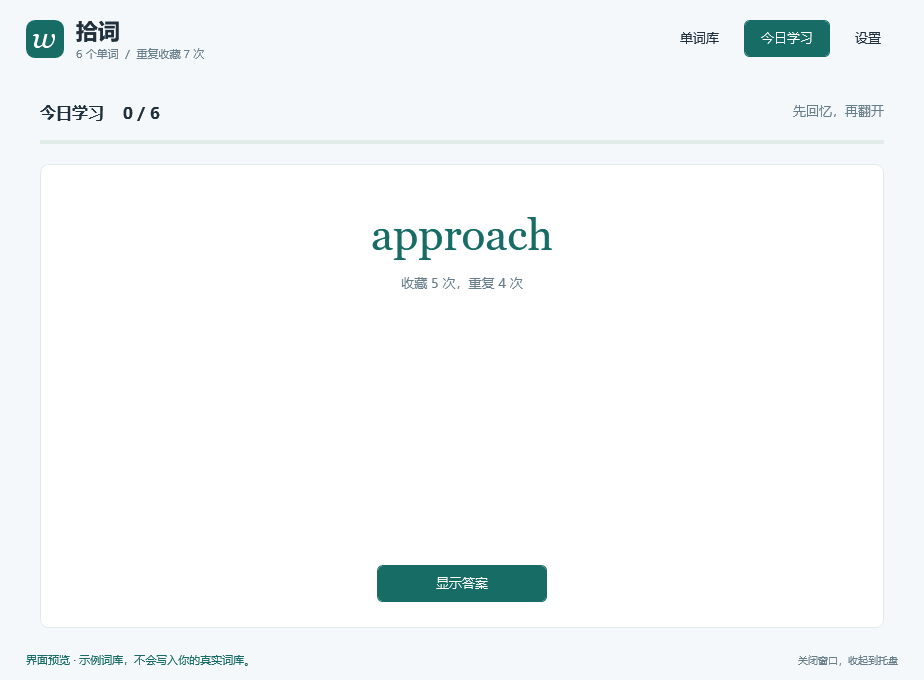

<p align="center">
  
</p>

<p align="center">
  <a href="https://github.com/guan695/my-words/releases/latest"></a>
  
  
  <a href="LICENSE"></a>
</p>

<p align="center">
  一个安静待在 Windows 托盘里的英语单词本。<br>
  收下你遇到的词，看见重复的次数，让 AI 帮你整理，每天再学一点。
</p>

<p align="center">
  <b><a href="https://github.com/guan695/my-words/releases/latest/download/MyWords-Windows-x64.zip">下载 Windows 版</a></b>
  · <a href="https://github.com/guan695/my-words/releases/latest/download/MyWords.mplugin">下载 Manggo 插件</a>
  · <a href="docs/guide.md">使用指南</a>
  · <a href="README.en.md">English</a>
</p>

## 为什么做拾词

有些单词，我们查过很多次，却还是记不住。我想先把「积累」这件事做好：读到一个词，顺手收藏；再遇到它，知道自己已经收藏过几次；打开单词本，就有整理好的词卡可以学。

拾词把这条流程连起来：**阅读 → 收藏 → 看见重复 → 整理词卡 → 每日学习。**


*截图来自实际 WPF 界面的离屏渲染，使用独立示例词库。首次使用时词库为空。*

## 能做什么

| 功能 | 日常使用方式 |
| --- | --- |
| **收藏与查重** | 输入单词或短语，按 Enter 收藏。重复收藏累计次数，词库只保留一条。 |
| **计数、搜索、排序** | 查看词库总量和重复收藏次数，按重复次数、字母或收录顺序找词。 |
| **DeepSeek 词卡** | 按你的提示词整理释义、音标、例句、翻译、搭配和记忆提示；每一项都能手动修改。 |
| **每日最多 20 词** | 从你自己的词库抽选。先回忆，再翻卡，标记「忘记了 / 模糊 / 记住了」。 |
| **Manggo Pro 联动** | 划词翻译后，一键收藏到拾词；重复时提示累计收藏与重复次数。 |
| **托盘常驻** | 关闭窗口即收起，点击托盘图标随时打开；无需一直占着任务栏。 |
| **本地保存与备份** | 词库保存在电脑上，支持 JSON 导入、导出；无需注册拾词账号。 |

<details>
<summary>看看「今日学习」</summary>



当天词表固定，重启不会重抽。词库不足 20 个时使用全部单词；忘记的、未学的和反复收藏的词会得到更高的抽选权重。

</details>

## 三步开始

1. **下载并解压** [Windows x64 完整版](https://github.com/guan695/my-words/releases/latest/download/MyWords-Windows-x64.zip)，打开其中的 `MyWords.exe`。完整版自带 .NET 运行环境，请保留整个文件夹。
2. **收下第一个词**：输入一个英文单词或短语，按 Enter。再次加入同一个词，就能看到重复次数。
3. **按需开启 AI**：在「设置」里填入自己的 DeepSeek API Key，保存后即可自动整理新词。已有的词可以点击「AI 整理」。

不配置 AI 也能收藏、编辑和学习。AI 调用使用你自己的 DeepSeek 账户，费用按其 API 规则计算；ChatGPT Pro 或 Manggo Pro 会员不包含 DeepSeek API 额度。模型名称可以在设置中修改。

面向 **Windows 10/11 x64**，目前界面为中文。已安装 [.NET 8 Desktop Runtime x64](https://dotnet.microsoft.com/en-us/download/dotnet/8.0) 的用户，可以选择体积更小的 [精简版](https://github.com/guan695/my-words/releases/latest/download/MyWords-Windows-x64-framework-dependent.zip)。版本更新与文件校验值见 [Releases](https://github.com/guan695/my-words/releases)。

## 和 Manggo 一起用

需要 **Manggo Pro**。拾词也可以独立使用。

1. 在 Manggo「插件管理」中，先点击 **初始化插件环境**，等待显示 **就绪 / Ready**。
2. 安装 [MyWords.mplugin](https://github.com/guan695/my-words/releases/latest/download/MyWords.mplugin)，在 Manggo 的生词本服务设置中添加「拾词」。
3. 在拾词「设置 → 连接 Manggo Pro」中复制连接口令，粘贴到 Manggo 的拾词服务配置并保存。
4. 保持拾词运行（收起到托盘也可以），划词翻译后选择收藏到拾词。

> 出现 `Plugin runtime environment is not initialized.`？先完成第 1 步。仅安装插件包还不够，Manggo 的插件运行环境也需要初始化。

完整步骤、快捷键、迁移与故障排查请看 **[使用指南](docs/guide.md)**。

## 数据如何保存

- 词库在 `%LOCALAPPDATA%\MyWords\words.json`，设置在同目录的 `settings.json`；发布包不包含任何人的词库或密钥。
- DeepSeek Key 使用 Windows 当前用户加密保护。AI 整理时，会向 DeepSeek 发送待整理的单词、已有释义、音标及你的提示词；不会发送整个词库。
- Manggo 插件仅连接本机 `127.0.0.1:17653`，使用连接口令验证请求，无需另外部署服务器。
- 同一个词保留一张词卡和累计次数，不保存收藏时间或每次新增的例句历史。重复收藏不会再次触发 AI，也不会覆盖你改好的词卡。
- 大小写和多余空白会统一处理；`run` 与 `running` 分别收录。例句和音标可以编辑，AI 内容仍需自行核对。

每天的词表采用加权抽选；当前版本尚未实现完整的间隔复习算法，也没有云同步、手机端或开机自启设置。

## 从源码构建

需要 Windows、[.NET 8 SDK](https://dotnet.microsoft.com/en-us/download/dotnet/8.0) 和 PowerShell。应用使用 WPF + Windows Forms 托盘图标，没有第三方 NuGet 依赖。

```powershell
git clone https://github.com/guan695/my-words.git
cd my-words

# 精简版：目标电脑需要 .NET 8 Desktop Runtime x64
.\scripts\build.ps1

# 完整版：自带运行环境，目标电脑无需另装 .NET
.\scripts\build.ps1 -SelfContained
```

输出在 `release/`。可用 `-DotnetPath` 指定 SDK 的 `dotnet.exe`，用 `-OutputRoot` 指定打包目录。针对性检查与项目结构见 [贡献指南](CONTRIBUTING.md)。

## 一起让它更好用

欢迎通过 [Issues](https://github.com/guan695/my-words/issues) 提交使用问题、建议，或贡献代码和文档。如果拾词帮你积累了更多单词，欢迎点一下右上角 **Star**，让更多有相同需求的人发现它。

感谢 [Manggo](https://manggo.pylogmon.cn/)、[Manggo 插件文档](https://github.com/Pylogmon/manggo-plugin) 和 [DeepSeek](https://api-docs.deepseek.com/)。拾词是独立社区项目，与上述产品没有官方隶属关系。

[MIT License](LICENSE) © 2026 [guan695](https://github.com/guan695)
